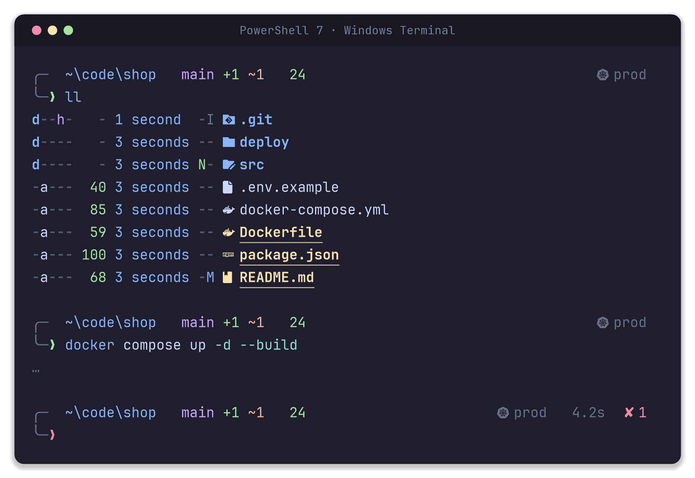
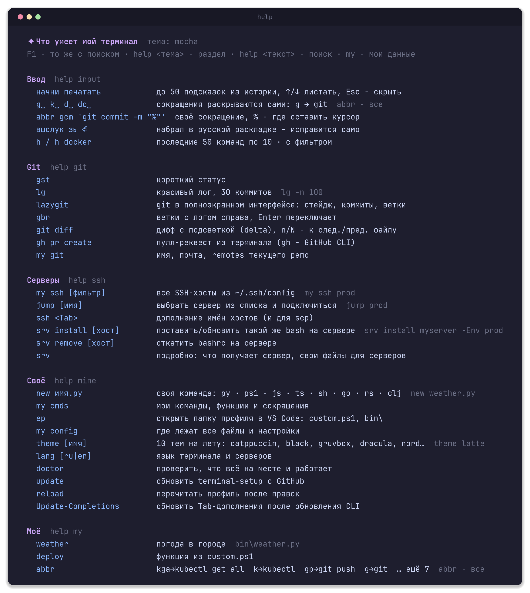
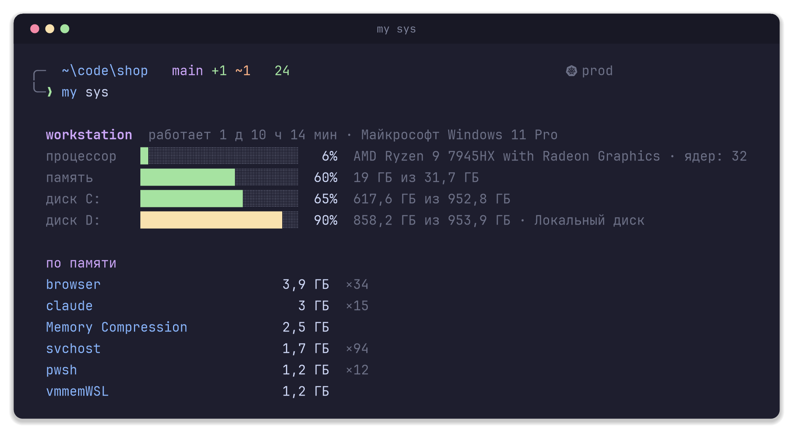
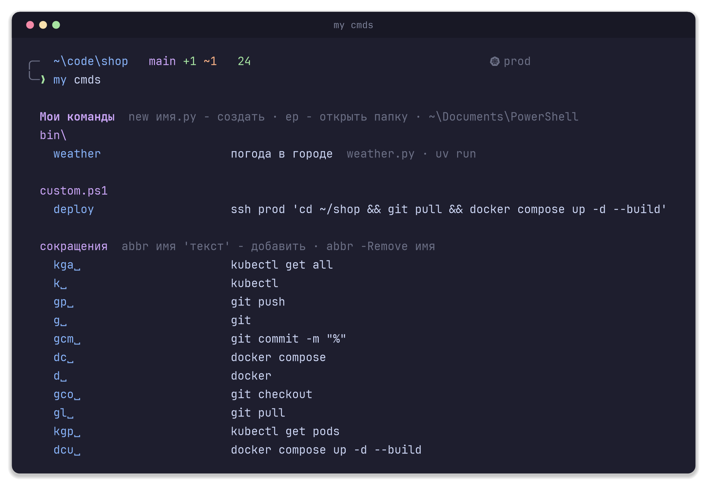
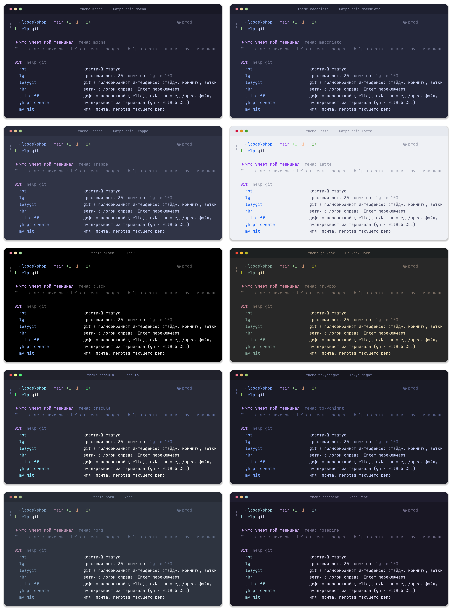
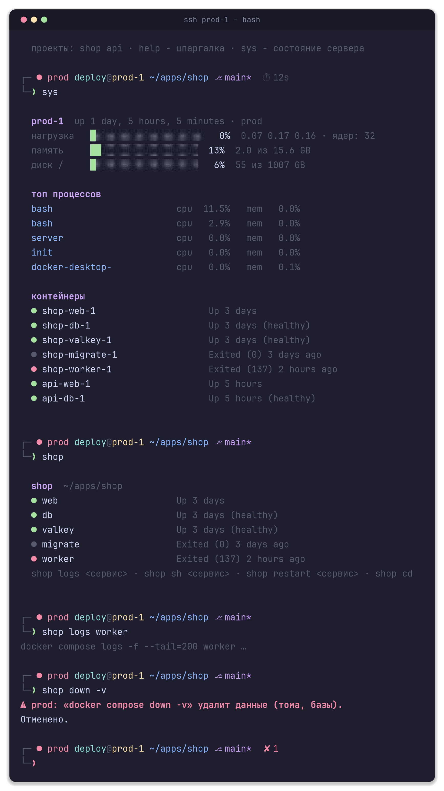

<h1 align="center">terminal-setup</h1>

<p align="center">
A Windows 11 terminal you actually want to open.<br>
One command installs and configures everything. One more gives your server the same bash.
</p>

<p align="center"><a href="README.md">Русский</a> · English</p>

<p align="center"></p>

## Why

A fresh PowerShell looks like it was designed for a printer. Doing it by hand takes a while: font, color scheme, prompt, highlighting, completions, a dozen tools, and you always forget something. terminal-setup does it for you and hands you a cheat sheet for everything it installed. You open the terminal and get to work.

- One palette for everything: Windows Terminal, prompt, input highlighting, `ls`, fzf, git diffs. Ten themes, switched live.
- The prompt shows what matters: folder, git branch with changes, node or python version inside a project, kubernetes context, duration of long commands, exit code.
- `help` and `F1` remember the commands for you. Abbreviations `g␣` → `git`, up to 50 history suggestions, keyboard-layout fix.
- Your own commands in any language: a file in `bin\` becomes a command, Python or Rust alike.
- Your server gets the same prompt, cheat sheet and a guard against `docker compose down -v`. Nothing installed, nothing running in the background.
- Running it again is safe. That is also how you update.

## Install

Open PowerShell (a regular one, not as administrator):

```powershell
irm https://raw.githubusercontent.com/Ange1oc/terminal-setup/main/install.ps1 | iex
```

The script asks for the language (`ru` or `en`), installs PowerShell 7 if it is missing and continues there. It asks for administrator rights once: the icon font has to be installed for all users, otherwise Windows Terminal cannot see it. When it is done, close all terminal windows, open a new one and press **F1**.

Any file that differs from the new version is saved next to it as `*.bak-<date>` before being replaced. Your `custom.ps1` and `bin\` folder are never touched.

<details>
<summary>Parameters and offline install</summary>

```powershell
& ([scriptblock]::Create((irm https://raw.githubusercontent.com/Ange1oc/terminal-setup/main/install.ps1))) -Lang en -Theme gruvbox -SshTabs prod,staging
```

| Parameter | What it does |
|---|---|
| `-Lang ru\|en` | UI language, later changed with `lang` |
| `-Theme <name>` | theme, later changed with `theme` |
| `-StartingDirectory D:\code` | folder a new tab opens in |
| `-SshTabs host1,host2` | tabs in the Windows Terminal menu for hosts from `~/.ssh/config` |
| `-SkipApps` | configs only, no programs or font |
| `-Uninstall` | remove everything of its own, keep `custom.ps1`, `bin\`, programs and `*.bak` files |

Offline: download [`setup-terminal.ps1`](setup-terminal.ps1) and run `powershell -ExecutionPolicy Bypass -File .\setup-terminal.ps1`. It is a single file with everything embedded.

</details>

## What is inside

| | |
|---|---|
| Programs | PowerShell 7, Windows Terminal, git, fzf, zoxide, eza, bat, ripgrep, fd, delta, lazygit, tldr, gh. Installed via winget, only the missing ones |
| Prompt | rendered by PowerShell itself in a few milliseconds, no external programs: the branch is read from `.git/HEAD`, the kubernetes context from kubeconfig, and git status counts are fetched in the background and drawn in once they are ready |
| Font | JetBrainsMono Nerd Font, with icons, for all users |
| Windows Terminal | PowerShell 7 by default, theme, font, padding, `Win+\`` drops the terminal over any window |
| Input | syntax highlighting, history suggestions, abbreviations, layout fix, `↑`/`↓` by prefix |
| Completions | kubectl, helm, docker, gh, kind, minikube, ssh hosts. Cached, startup does not pay for them |
| VS Code and git | the same font in the integrated terminal, diffs through delta in the same colors |

The profile starts in about half a second: only the core loads up front, while the command dictionary, completions and zoxide load right after the prompt is on screen.

## Cheat sheet

<p align="center"></p>

`help` shows everything by section, `help git` one section, `help docker` searches the text. **F1** opens the same cheat sheet in fzf: find a command, press Enter, it is in the input line.

## Input

| | |
|---|---|
| `g␣` `k␣` `d␣` `dc␣` | abbreviations expand on space into `git`, `kubectl`, `docker`, `docker compose`. History keeps the full commands. Your own: `abbr gcm 'git commit -m "%"'`, `%` marks the cursor |
| `вщслук зы` ⏎ | a command typed in the Russian layout is fixed and executed as `docker ps` |
| start typing | up to 50 suggestions from history (PSReadLine's built-in limit is 10), `↑`/`↓` scroll, `→` accepts |
| `Ctrl+R` · `Ctrl+T` | fzf: history search, insert a file path |
| `Alt+C` · `nav` | folders as a tree with a preview pane: `→` enter, `←` up, Enter go, `Ctrl+E` show files too, `Ctrl+H` hidden, `Ctrl+F` fuzzy search through every folder below, `Ctrl+O` open in Explorer |
| `pv` · `rgi TODO` | files with a preview pane (Enter opens, `Ctrl+P` prints here) · live grep: type and the list updates, Enter opens the file at that line |
| `pk node` · `gbr` · `o file` | pick a process and kill it · git branches with their log, Enter switches · open with the default app |
| `h` · `h docker` | last 50 commands, 10 per page, optionally filtered |
| `Ctrl+Backspace` · `Ctrl+Z` · `Shift+Enter` | delete word, undo, new line without running |

## `my`: everything about this machine

<p align="center"></p>

`my sys` · `my ssh` · `my ports 5432` · `my ip public` · `my k8s` · `my docker` · `my tools` · `my path` · `my git` · `my cmds` · `my config`

Small helpers that exist on the server too: `ex archive` extracts zip, tar.gz, 7z; `bak file` makes a copy before editing; `psg node` finds processes; `ll | cb` puts the output into the clipboard.

## Your own commands in any language

<p align="center"></p>

```powershell
new weather.py 'weather in a city'   # creates bin\weather.py from a template and opens it in VS Code
weather Minsk                        # already a command, no restart
```

A file in `bin\` next to the profile is a command. A `# help: …` line at the top becomes its caption in `help` and `my cmds`. The extension picks the runner: `.py` via **uv** (dependencies right in the file, `# /// script`), `.ps1`, `.js`, `.ts` (bun, deno or node), `.sh`, `.go`, `.rs` (rust-script), `.clj` (babashka), `.rb`, `.lua`, `.php`. A compiled `.exe` just goes into `bin\`.

`custom.ps1` in the same folder holds your functions, abbreviations and switches. It loads last, is never overwritten, and its functions show up in `help`. `ep` opens the profile folder in VS Code.

## Themes

<p align="center"></p>

`theme gruvbox`, and the terminal, prompt, input highlighting, fzf and diffs switch at once, in every open tab. Included: Catppuccin Mocha, Macchiato, Frappe and Latte (light), Black for OLED, Gruvbox Dark, Dracula, Tokyo Night, Nord, Rose Pine. Every theme is one row in `palette.ps1`: add yours and it shows up everywhere.

`lang ru` switches the language of `help`, `my` and every message. Servers pick it up on the next `srv install`.

## Servers

```powershell
srv install prod -Env prod        # install or update, with a label in the prompt
srv install                       # no host: pick one from ~/.ssh/config
srv remove prod                   # roll back
```

<p align="center"></p>

One ssh connection, a backup and a trial load before anything is replaced, one line added to `~/.bashrc`. Running it again breaks nothing. Not a single program is installed and not a single background process is started on the server, only functions in your shell. That is why it is fine on production.

- Projects are discovered with `docker compose ls` and remembered. Each gets a command of its own name: `shop`, `shop logs web`, `shop sh web`, `shop restart web`, `app shop`. Tab completes services. `proj` lists all projects, `proj add` adds a folder by hand.
- A prompt with an environment label (`prod` red, `staging` yellow, `dev` green), git branch, duration of long commands and exit code.
- Guards: `docker compose down -v`, `volume rm`, `system prune` require typing `yes`; `rm`, `cp`, `mv` ask before mass changes. Scripts are unaffected.
- `sys` shows load, memory, disk, processes and containers. `help` searches the cheat sheet. `bak`, `ex`, `psg`, `h` work the same way as on Windows.
- Your own files for servers: `server\custom\*.sh` next to the profile go to every server into `~/.bashrc.d/`. Scripts in `~/bin` and `# help: name - description` lines show up in `help` on the server.

## Where things live

`my config` lists every path with a check mark, `doctor` verifies that everything is in place and working.

| | |
|---|---|
| `~\Documents\PowerShell\` | profile and commands, your `custom.ps1`, `bin\`, `server\custom\`. This is the `$PROFILE` folder; with Documents redirected to OneDrive it lives there and syncs between machines |
| `~\.config\terminal-setup\` | `theme`, `lang` |
| `~\.cache\terminal-setup\`, `~\.cache\pwsh-*` | caches, safe to delete, rebuilt automatically |
| `%LOCALAPPDATA%\Packages\Microsoft.WindowsTerminal_*\LocalState\settings.json` | Windows Terminal |
| `%APPDATA%\Code\User\settings.json`, `~\.gitconfig` | VS Code terminal font, delta for git |

## Update and uninstall

`update` downloads the installer from GitHub and updates whatever changed. Running the install command again does the same. `setup-terminal.ps1 -Uninstall` removes the profile files and caches, everything else stays. A single file can be rolled back from the `*.bak-<date>` next to it; on a server there is `srv remove <host>`.

## How it is built

```
install.ps1           one-line installer: downloads setup-terminal.ps1 and runs it
setup-terminal.ps1    everything in one file, built from src/, do not edit by hand
build.ps1             .\build.ps1  ·  .\build.ps1 -FromProfile pulls the setup from this machine
src/
  setup-logic.ps1     installer logic
  profile/            profile, prompt.ps1 (prompt), palette.ps1 (themes), lang.ps1 (ru/en strings), toolkit.ps1 and toolkit-lazy.ps1 (commands), suggestions plugin
  server/             bashrc.local, inputrc and the installer behind srv
tools/                make-screenshots.ps1: the images in docs/ come from real command output
```

Make it yours: edit the files in the profile folder (`ep`), then `.\build.ps1 -FromProfile`, commit and push. The next install picks up the new version.

## Questions

**No winget?** Install "App Installer" from the Microsoft Store and run the command again. Or run with `-SkipApps` and install the programs yourself.

**Can I skip the icon font?** Yes, you get Cascadia Mono and boxes instead of icons. The script warns you.

**I broke custom.ps1 and the terminal complains on start.** The profile survives it and loads anyway. `doctor` shows the line with the error.

**I want my own theme.** Copy any block in `palette.ps1`, change the colors, run `theme <name>`.
