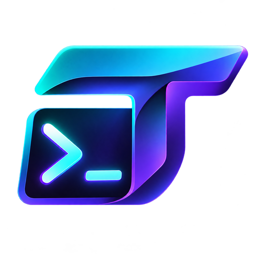
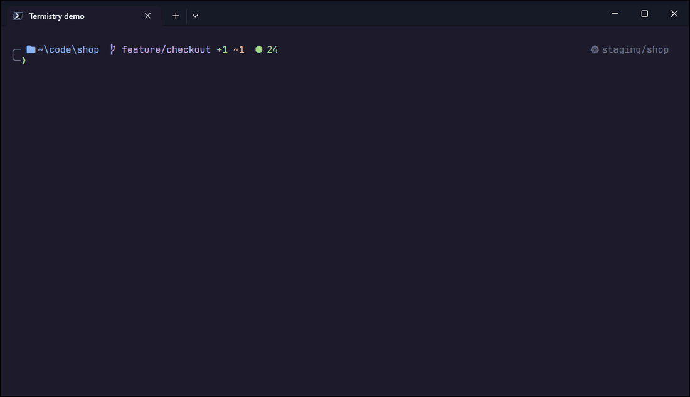
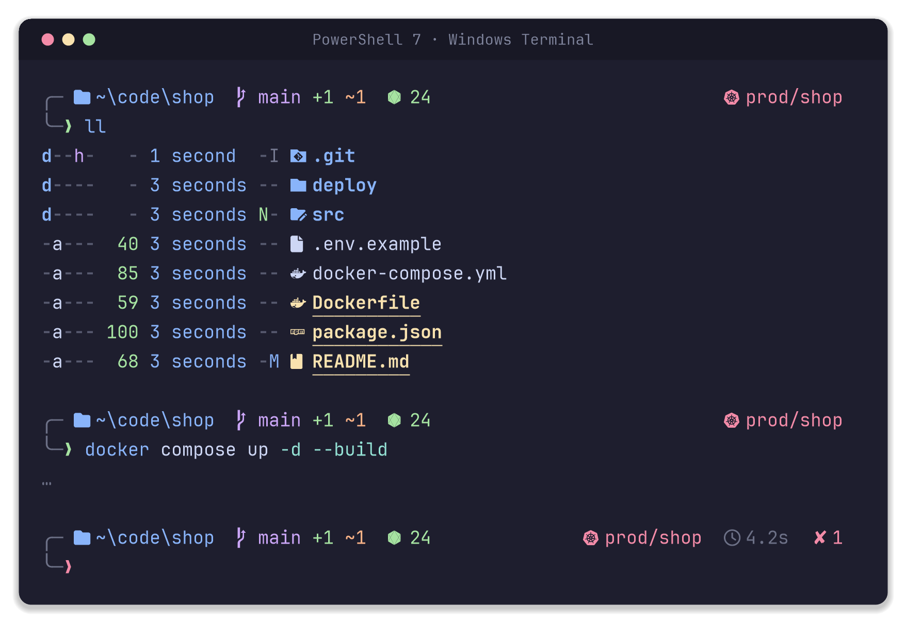
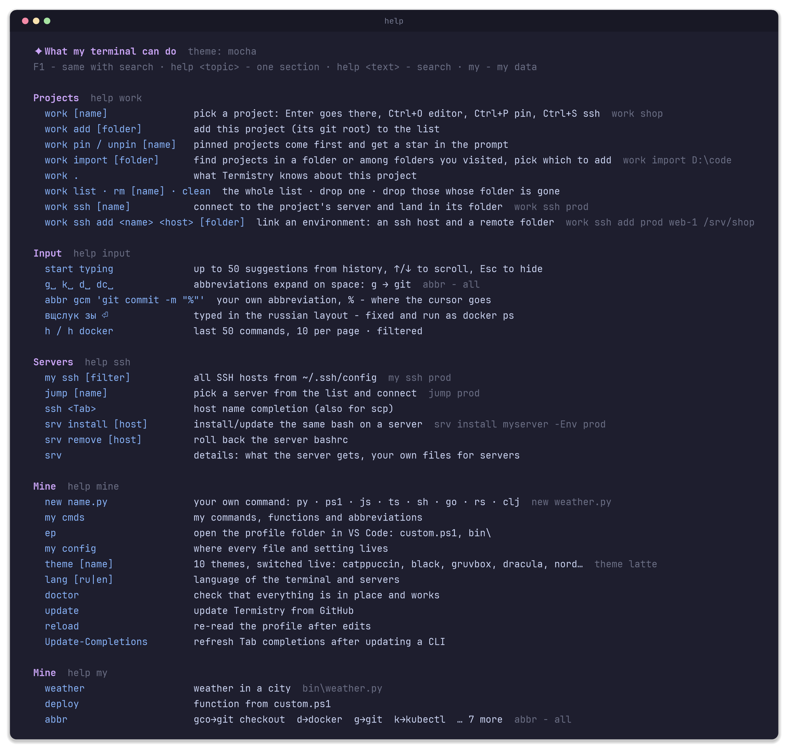
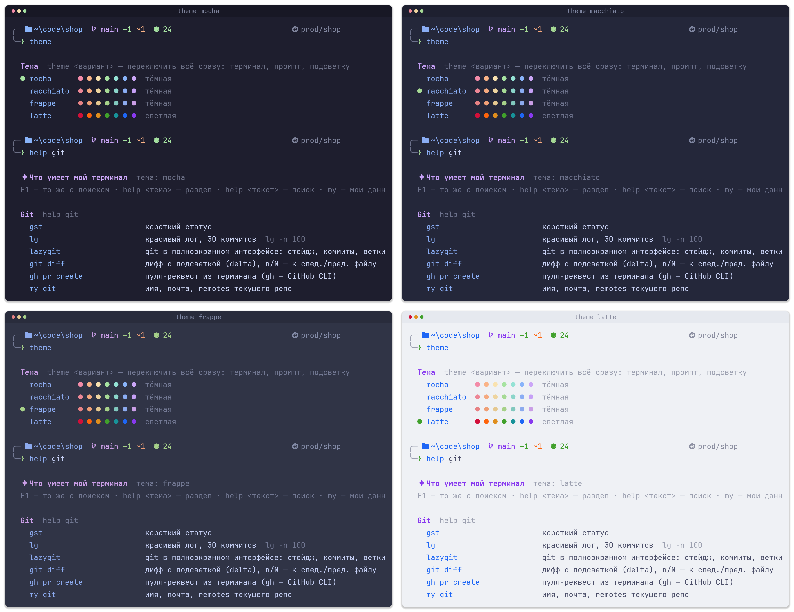
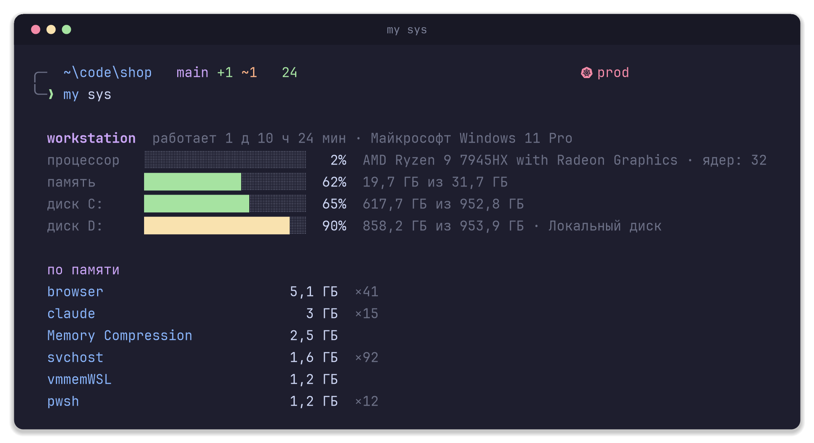
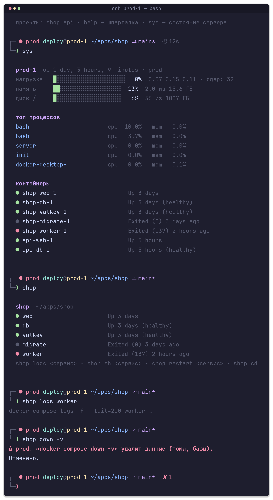
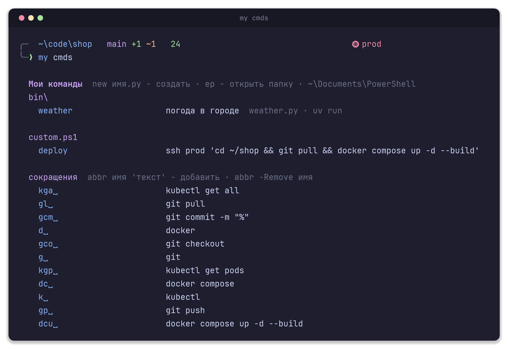

<p align="center">
  
</p>

<h1 align="center">Termistry</h1>

<p align="center"><b>Your terminal. Beautifully configured.</b></p>

<p align="center">
A Windows 11 terminal you actually want to open. One command installs and configures PowerShell 7,<br>
Windows Terminal, a fast prompt, fzf navigation and a cheat sheet. One more gives your Linux servers the same bash.
</p>

<p align="center">
  <a href="https://github.com/Ange1oc/termistry/actions/workflows/tests.yml"></a>
  <a href="https://github.com/Ange1oc/termistry/releases/latest"></a>
  <a href="LICENSE"></a>
  
</p>

<p align="center"><b>English</b> · <a href="README.ru.md">Русский</a></p>

<p align="center"></p>

## Contents

- [Why Termistry](#why-termistry)
- [Install](#install)
- [Requirements and what gets installed](#requirements-and-what-gets-installed)
- [Prompt, themes and input](#prompt-themes-and-input)
- [Git, Docker, Kubernetes and SSH](#git-docker-kubernetes-and-ssh)
- [Linux servers](#linux-servers)
- [Customization](#customization)
- [Update, uninstall and backups](#update-uninstall-and-backups)
- [Security](#security)
- [FAQ](#faq)
- [Development](#development)
- [License](#license)

## Why Termistry

A fresh PowerShell looks like it was designed for a printer. Doing it by hand takes a while: font, color scheme, prompt, highlighting, completions, a dozen tools, and you always forget something. Termistry does it for you and hands you a cheat sheet for everything it installed. You open the terminal and get to work.

- **One palette for everything.** Windows Terminal, prompt, input highlighting, `ls`, fzf and git diffs share the same colors. Ten themes, switched live.
- **A prompt that shows what matters** and renders in a few milliseconds: folder, git branch with changes, node or python version inside a project, duration of long commands, exit code. The Kubernetes context appears only where it belongs, and in red everywhere when kubectl points at prod.
- **`help` and `F1` remember commands for you.** Abbreviations `g␣` → `git`, up to 50 history suggestions, a fix for commands typed in the Russian keyboard layout.
- **fzf everywhere:** folder tree navigation, file previews, live grep, git branches, processes, kubectl contexts.
- **Your own commands in any language:** a file in `bin\` becomes a command, Python or Rust alike.
- **Your servers get the same prompt**, cheat sheet and a guard against `docker compose down -v`. Nothing is installed there and nothing runs in the background.
- **English and Russian interface**, switched with `lang en` / `lang ru`.
- **Running it again is safe.** That is also how you update.

## Install

Open PowerShell (a regular one, not as administrator) and run:

```powershell
irm https://raw.githubusercontent.com/Ange1oc/termistry/master/install.ps1 | iex
```

The script asks for the language (`en` or `ru`), installs PowerShell 7 if it is missing and continues there. It asks for administrator rights once: the icon font has to be installed for all users, otherwise Windows Terminal cannot see it. When it is done, close all terminal windows, open a new one and press **F1**.

Prefer to read the script before running it? See [Verified install](#verified-install).

<details>
<summary><b>Parameters</b></summary>

```powershell
& ([scriptblock]::Create((irm https://raw.githubusercontent.com/Ange1oc/termistry/master/install.ps1))) -Lang en -Theme gruvbox -SshTabs prod,staging
```

| Parameter | What it does |
|---|---|
| `-Lang en\|ru` | interface language, later changed with `lang` |
| `-Theme <name>` | theme, later changed with `theme` |
| `-StartingDirectory D:\code` | folder a new tab opens in |
| `-SshTabs host1,host2` | tabs in the Windows Terminal menu for hosts from `~/.ssh/config` |
| `-SkipApps` | configs only, no programs or font |
| `-Uninstall` | remove everything of its own, keep `custom.ps1`, `bin\`, programs and `*.bak` files |
| `-ProfileDir D:\pwsh` | put the profile files somewhere other than the `$PROFILE` folder (the tests use it) |

</details>

### Verified install

`setup-terminal.ps1` is a single self-contained file. Every release publishes it together with `SHA256SUMS`, so you can download a fixed version, check it, read it and only then run it:

```powershell
$v = 'v1.0.1'
$dir = New-Item -ItemType Directory -Force "$env:TEMP\termistry-$v"
foreach ($f in 'setup-terminal.ps1', 'SHA256SUMS') {
    Invoke-WebRequest "https://github.com/Ange1oc/termistry/releases/download/$v/$f" -OutFile "$dir\$f" -UseBasicParsing
}
$expected = ((Get-Content "$dir\SHA256SUMS") -match 'setup-terminal\.ps1$' -split '\s+')[0]
if ((Get-FileHash "$dir\setup-terminal.ps1" -Algorithm SHA256).Hash -ne $expected) { throw 'Checksum mismatch' }
notepad "$dir\setup-terminal.ps1"                                  # read it
powershell -ExecutionPolicy Bypass -File "$dir\setup-terminal.ps1"  # then run it
```

Or build it yourself from source: `git clone https://github.com/Ange1oc/termistry`, then `.\build.ps1` and `.\setup-terminal.ps1`. Offline machines only need that one file.

## Requirements and what gets installed

**Requirements**

- Windows 11 with winget ("App Installer" from the Microsoft Store). Windows 10 is not tested.
- Windows PowerShell 5.1 or PowerShell 7 to start the installer. The profile itself runs in PowerShell 7.
- Internet access and one administrator confirmation (UAC) for the font.
- For servers: Linux with bash 4 or newer and SSH access. Docker is optional.

**What gets installed** (via winget, only what is missing)

| | |
|---|---|
| Shell and terminal | PowerShell 7, Windows Terminal |
| Tools | git, [fzf](https://github.com/junegunn/fzf), [zoxide](https://github.com/ajeetdsouza/zoxide), [eza](https://github.com/eza-community/eza), [bat](https://github.com/sharkdp/bat), [ripgrep](https://github.com/BurntSushi/ripgrep), [fd](https://github.com/sharkdp/fd), [delta](https://github.com/dandavison/delta), [lazygit](https://github.com/jesseduffield/lazygit), [tldr](https://github.com/tldr-pages/tlrc), [gh](https://cli.github.com) |
| PowerShell module | [PSFzf](https://github.com/kelleyma49/PSFzf) from the PowerShell Gallery |
| Font | [JetBrainsMono Nerd Font](https://github.com/ryanoasis/nerd-fonts) v3.4.0, for all users |

**What gets configured**

| | |
|---|---|
| PowerShell profile | `~\Documents\PowerShell\`: prompt, themes, commands, completions, history suggestions |
| Windows Terminal | PowerShell 7 by default, theme, font, padding, `Win+\`` drops the terminal over any window, optional SSH tabs |
| VS Code | the same font in the integrated terminal |
| git | diffs through delta in the terminal colors |

The profile starts in about half a second: only the core loads up front, while the command dictionary, completions and zoxide load right after the prompt is on screen.

## Prompt, themes and input

<p align="center"></p>


The prompt is rendered by PowerShell itself, no external programs: the branch is read from `.git/HEAD`, the Kubernetes context from kubeconfig, and git status counts are fetched in the background and drawn in once they are ready.

### Cheat sheet

<p align="center"></p>

`help` shows everything by section, `help git` one section, `help docker` searches the text. **F1** opens the same cheat sheet in fzf: find a command, press Enter, it is in the input line.

### Themes and language

<p align="center"></p>

`theme gruvbox`, and the terminal, prompt, input highlighting, fzf and diffs switch at once, in every open tab. Included: Catppuccin Mocha, Macchiato, Frappe and Latte (light), Black for OLED, Gruvbox Dark, Dracula, Tokyo Night, Nord, Rose Pine. `theme` without a name lists them.

`lang ru` switches `help`, `my` and every message to Russian, `lang en` back to English. Servers pick it up on the next `srv install`.

### Input, completion and fzf

| | |
|---|---|
| start typing | up to 50 suggestions from history (PSReadLine's built-in limit is 10), `↑`/`↓` scroll, `→` accepts |
| `g␣` `k␣` `d␣` `dc␣` | abbreviations expand on space into `git`, `kubectl`, `docker`, `docker compose`. History keeps the full commands |
| `вщслук зы` ⏎ | a command typed in the Russian layout is fixed and executed as `docker ps` |
| `Tab` | completions for kubectl, helm, docker, gh, kind, k3d, minikube and ssh hosts, cached so startup does not pay for them |
| `Ctrl+R` · `Ctrl+T` | fzf: history search, insert a file path with a preview |
| `Alt+C` · `nav` | folders as a tree with a preview pane: `→` enter, `←` up, Enter go, `Ctrl+E` show files too, `Ctrl+H` hidden, `Ctrl+F` fuzzy search through every folder below, `Ctrl+O` open in Explorer |
| `z <part>` | jump to a frequently used folder (zoxide) |
| `pv` · `rgi TODO` | files with a preview pane · live grep: type and the list updates, Enter opens the file at that line |
| `pk node` · `o file` | pick a process and kill it · open with the default app |
| `h` · `h docker` | last 50 commands, 10 per page, optionally filtered |
| `Ctrl+Backspace` · `Ctrl+Z` · `Shift+Enter` | delete word, undo, new line without running |

### `my`: everything about this machine

<p align="center"></p>

`my sys` · `my ssh` · `my ports 5432` · `my ip public` · `my k8s` · `my docker` · `my tools` · `my path` · `my git` · `my cmds` · `my config` · `my keys`

Small helpers that exist on the server too: `ex archive` extracts zip, tar.gz, 7z; `bak file` makes a copy before editing; `psg node` finds processes; `ll | cb` puts the output into the clipboard.

## Git, Docker, Kubernetes and SSH

| | |
|---|---|
| Git | branch and change counters in the prompt, `gst`, `lg`, `gbr` (branches with their log, Enter switches), `lazygit`, diffs through delta, `my git` |
| Docker | `my docker` lists containers and compose projects, completions for `docker`, `d␣` and `dc␣` abbreviations |
| Kubernetes | the context shows in folders with `Chart.yaml`, `kustomization.yaml`, `k8s/`, `helm/` and similar, and always in red for prod. `kctx` and `kns` switch context and namespace from a list, `my k8s` shows them all. `$Termistry.Kube = 'always'` or `'off'` changes when it is shown |
| SSH | `my ssh` lists hosts from `~/.ssh/config`, `jump` picks one and connects, `ssh <Tab>` completes host names, `-SshTabs` adds hosts to the Windows Terminal menu, `srv` installs the server bash |

## Linux servers

```powershell
srv install prod -Env prod        # install or update, with a label in the prompt
srv install                       # no host: pick one from ~/.ssh/config
srv remove prod                   # roll back
```

<p align="center"></p>

One ssh connection, a backup and a trial load before anything is replaced, one line added to `~/.bashrc`. Running it again breaks nothing. Not a single program is installed and not a single background process is started on the server, only functions in your shell. That is why it is fine on production.

- Projects are discovered with `docker compose ls` and remembered. Each gets a command of its own name: `shop`, `shop logs web`, `shop sh web`, `shop restart web`. Tab completes services. `proj` lists all projects, `proj add` adds a folder by hand.
- A prompt with an environment label (`prod` red, `staging` yellow, `dev` green), git branch, duration of long commands and exit code.
- Guards: `docker compose down -v`, `volume rm`, `system prune` require typing `yes`; `rm`, `cp`, `mv` ask before mass changes. Scripts are unaffected.
- `sys` shows load, memory, disk, processes and containers. `help` searches the cheat sheet. `bak`, `ex`, `psg`, `h` work the same way as on Windows.
- Per-server settings live in `~/.config/bashrc-local.conf` (`PROMPT_ENV=prod`, `LANG_UI=en`).
- Your own files for servers: `server\custom\*.sh` next to the profile go to every server into `~/.bashrc.d/`. `help` on the server also lists scripts from `~/bin` (caption from a `# help: …` line) and functions from `~/.bashrc.d/*.sh`.

## Customization

<p align="center"></p>

**Your own commands in any language.** A file in `bin\` next to the profile is a command:

```powershell
new weather.py 'weather in a city'   # creates bin\weather.py from a template and opens it in VS Code
weather Berlin                       # already a command, no restart
```

A `# help: …` line at the top becomes its caption in `help` and `my cmds`. The extension picks the runner: `.py` via **uv** (dependencies right in the file, `# /// script`), `.ps1`, `.js`, `.ts` (bun, deno or node), `.sh`, `.go`, `.rs` (rust-script), `.clj` (babashka), `.rb`, `.lua`, `.php`. A compiled `.exe` just goes into `bin\`. A taken name is never overridden: `new git.py` refuses, and a file named after a real program yields to it.

**`custom.ps1`** in the same folder holds your functions, abbreviations and switches. It loads last, is never overwritten, and its functions show up in `help`. `ep` opens the profile folder in VS Code.

```powershell
$Termistry.Abbreviations = $false     # turn off g␣ → git␣
$Termistry.LayoutFix     = $false     # turn off the keyboard layout fix
$Termistry.Predictions   = 20         # number of history suggestions
$Termistry.Kube          = 'always'   # Kubernetes context: auto, always, off

abbr gcm 'git commit -m "%"'          # % marks the cursor
function deploy { ssh prod 'cd app && git pull && docker compose up -d' }   # shows up in help
```

**Your own theme.** Every theme is one block in `palette.ps1`: copy one, change the colors, run `theme <name>`.

**Where things live.** `my config` lists every path with a check mark, `doctor` verifies that everything is in place and working.

| | |
|---|---|
| `~\Documents\PowerShell\` | profile and commands, your `custom.ps1`, `bin\`, `server\custom\`. This is the `$PROFILE` folder; with Documents redirected to OneDrive it lives there and syncs between machines |
| `~\.config\termistry\` | `theme`, `lang` |
| `~\.cache\termistry\`, `~\.cache\pwsh-*` | caches, safe to delete, rebuilt automatically |
| `%LOCALAPPDATA%\Packages\Microsoft.WindowsTerminal_*\LocalState\settings.json` | Windows Terminal |
| `%APPDATA%\Code\User\settings.json`, `~\.gitconfig` | VS Code terminal font, delta for git |

## Update, uninstall and backups

- **Update:** `update` downloads the installer from this repository and updates whatever changed. Running the install command again does the same.
- **Backups:** profile files, Windows Terminal and VS Code settings that differ from the new version are saved next to themselves as `*.bak-<date>` before being replaced. git settings are changed with `git config`. Your `custom.ps1` and `bin\` are never touched.
- **Uninstall:** removes the profile files and caches; programs, the font, `custom.ps1`, `bin\` and `*.bak` files stay.

  ```powershell
  & ([scriptblock]::Create((irm https://raw.githubusercontent.com/Ange1oc/termistry/master/install.ps1))) -Uninstall
  ```

- **Servers:** `srv remove <host>` restores the server `~/.bashrc`.
- **Coming from terminal-setup:** Termistry is the new name of [terminal-setup](https://github.com/Ange1oc/terminal-setup). Run the install command once: your theme and language move from `~\.config\terminal-setup` to `~\.config\termistry`, and a `custom.ps1` that uses `$TerminalSetup` keeps working.

## Security

- The installer runs as a regular user and asks for elevation only to install the font machine-wide.
- Programs come from the official winget source, PSFzf from the PowerShell Gallery, the font from a pinned Nerd Fonts release. Nothing else is downloaded.
- No telemetry, no background services, no scheduled tasks.
- On servers nothing is installed: `srv install` copies shell files over your own ssh connection, backs up the files it replaces, checks their syntax and loads them in a trial shell before switching.
- `irm … | iex` runs code from the internet. If that is not acceptable, use the [verified install](#verified-install).

Found a vulnerability? Please report it privately through [GitHub security advisories](https://github.com/Ange1oc/termistry/security/advisories/new) instead of a public issue.

## FAQ

**No winget?** Install "App Installer" from the Microsoft Store and run the command again. Or run with `-SkipApps` and install the programs yourself.

**Does it change Windows PowerShell 5.1?** No. The profile lives in the PowerShell 7 folder; Windows PowerShell keeps its own.

**Can I skip the icon font?** Yes, you get Cascadia Mono and boxes instead of icons. The script warns you.

**I broke custom.ps1 and the terminal complains on start.** The profile survives it and loads anyway. `doctor` shows the line with the error.

**Startup feels slow.** `doctor` measures it. Completions are cached; after updating a CLI run `Update-Completions`.

**I do not need the Russian parts.** Choose `en` at install time or run `lang en`. The keyboard layout fix only reacts to commands typed in the Russian layout and can be turned off with `$Termistry.LayoutFix = $false`.

## Development

```
install.ps1           one-line installer: downloads setup-terminal.ps1 and runs it
setup-terminal.ps1    everything in one file, built from src/, do not edit by hand
build.ps1             .\build.ps1  ·  .\build.ps1 -FromProfile pulls the setup from this machine
src/
  setup-logic.ps1     installer logic
  profile/            profile, prompt.ps1, palette.ps1 (themes), lang.ps1 (en/ru strings),
                      toolkit.ps1 and toolkit-lazy.ps1 (commands), history suggestions plugin
  server/             bashrc.local, inputrc and the installer behind srv
tests/                .\tests\run.ps1: profile, prompt, installer and server bash, all in a sandbox
tools/                make-screenshots.ps1 and record-demo.ps1: the images in docs/ come from real output
```

- `.\tests\run.ps1` runs every check without touching your real profile; `-Only static,profile,setup,server` picks parts. The server part needs WSL; CI runs it on Ubuntu with `bash tests/server.sh src/server`.
- After changing anything in `src\`, run `.\build.ps1` and commit `setup-terminal.ps1` too; CI fails if it is out of date.
- `.\tools\make-screenshots.ps1 -Lang en` regenerates `docs\*.png`, `.\tools\record-demo.ps1` records `docs\demo.gif` from a real Windows Terminal window.
- User-facing strings live in `src\profile\lang.ps1` and `src\setup-logic.ps1` in both languages; keep them in sync.

Issues and pull requests are welcome.

## License

Termistry is released under the [0BSD license](LICENSE): use, copy, modify and distribute it for any purpose, no attribution required.

The programs, PowerShell module and font that the installer downloads are not part of this repository and keep their own licenses. Theme palettes follow the published color schemes of [Catppuccin](https://github.com/catppuccin/catppuccin), [Gruvbox](https://github.com/morhetz/gruvbox), [Dracula](https://draculatheme.com), [Tokyo Night](https://github.com/enkia/tokyo-night-vscode-theme), [Nord](https://www.nordtheme.com) and [Rosé Pine](https://rosepinetheme.com).
