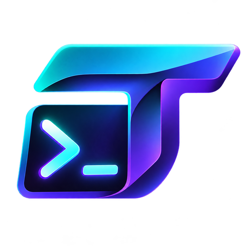
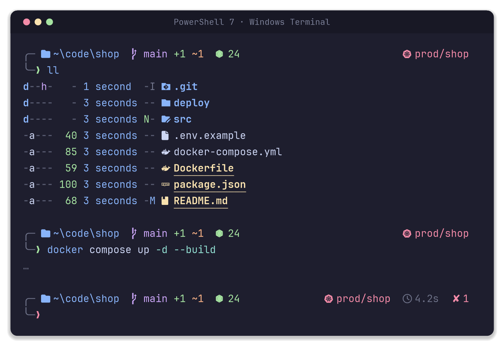
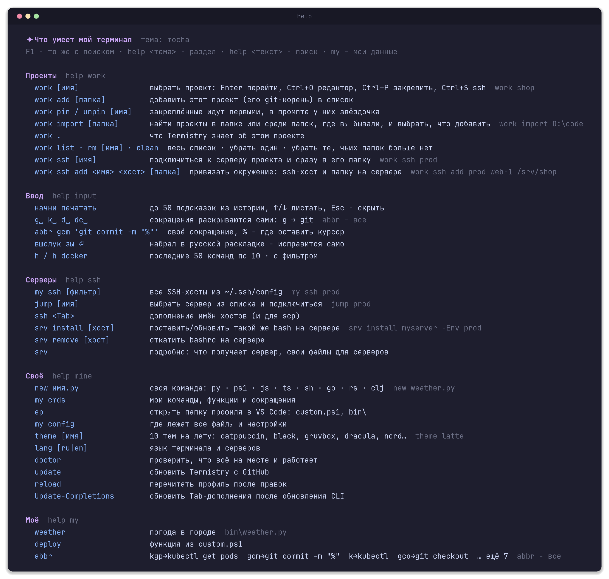
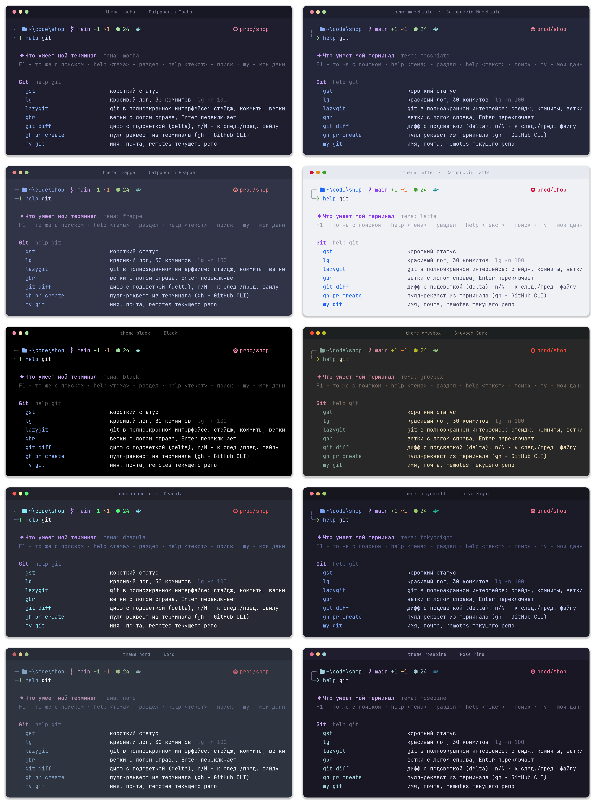
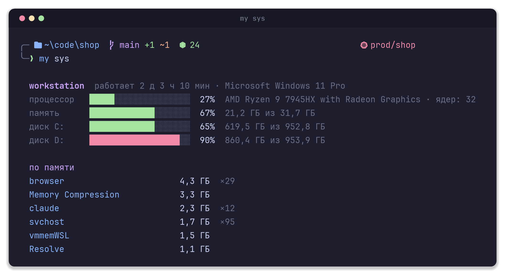
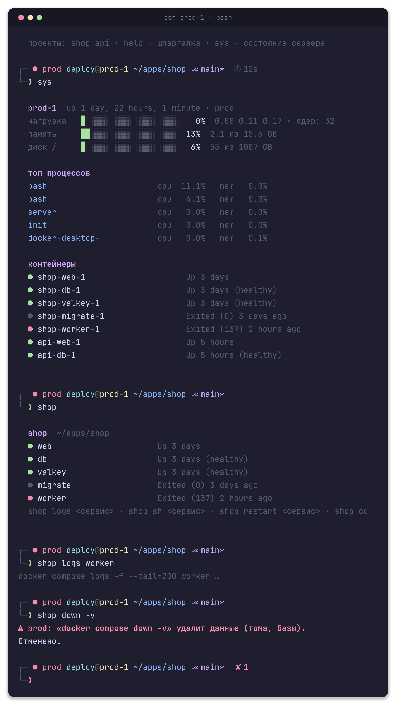
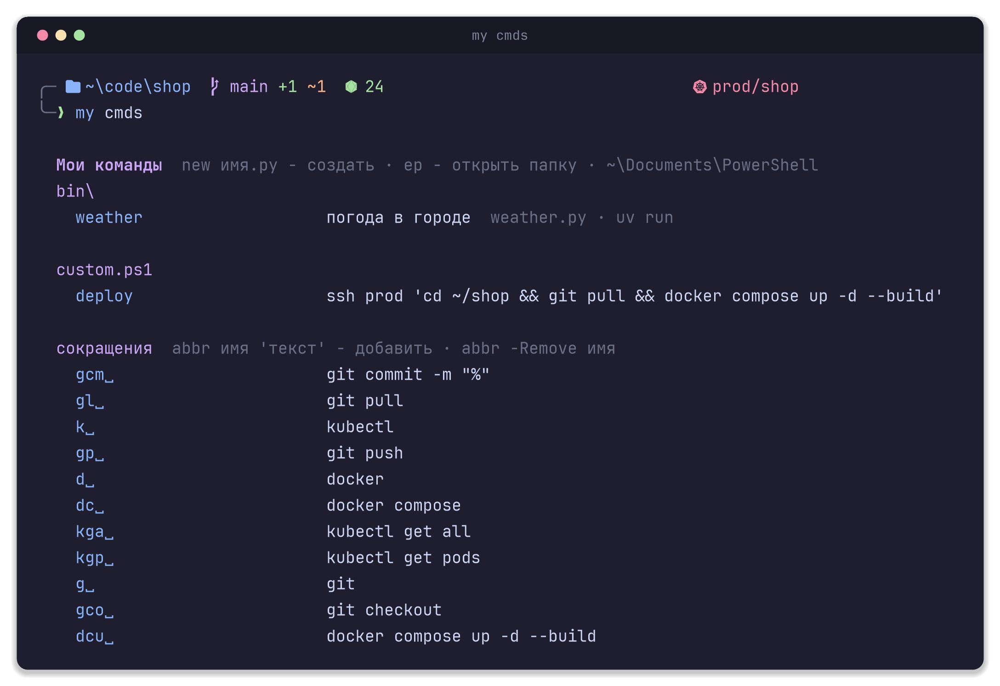

<p align="center">
  
</p>

<h1 align="center">Termistry</h1>

<p align="center"><b>Your terminal. Beautifully configured.</b></p>

<p align="center">
Терминал на Windows 11, который приятно открывать. Одна команда ставит и настраивает PowerShell 7,<br>
Windows Terminal, быстрый промпт, навигацию на fzf и шпаргалку. Ещё одна делает такой же bash на ваших Linux-серверах.
</p>

<p align="center">
  <a href="https://github.com/Ange1oc/termistry/actions/workflows/tests.yml"></a>
  <a href="https://github.com/Ange1oc/termistry/releases/latest"></a>
  <a href="LICENSE"></a>
  
</p>

<p align="center"><a href="README.md">English</a> · <b>Русский</b></p>

<p align="center"></p>


## Содержание

- [Зачем](#зачем)
- [Установка](#установка)
- [Требования и что ставится](#требования-и-что-ставится)
- [Промпт, темы и ввод](#промпт-темы-и-ввод)
- [Git, Docker, Kubernetes и SSH](#git-docker-kubernetes-и-ssh)
- [Linux-серверы](#linux-серверы)
- [Настройка под себя](#настройка-под-себя)
- [Обновление, удаление и резервные копии](#обновление-удаление-и-резервные-копии)
- [Безопасность](#безопасность)
- [Вопросы](#вопросы)
- [Разработка](#разработка)
- [Лицензия](#лицензия)

## Зачем

Голый PowerShell выглядит так, будто его делали для принтера. Настраивать его руками долго: шрифт, схема, промпт, подсветка, автодополнения, пара десятков утилит, и каждый раз что-то забываешь. Termistry делает это за вас и даёт шпаргалку по всему, что поставил. Вы открываете терминал и сразу работаете.

- **Одна палитра на всё.** Windows Terminal, промпт, подсветка ввода, `ls`, fzf и диффы git в одних цветах. Десять тем, переключаются на лету.
- **Промпт показывает то, что важно,** и рисуется за несколько миллисекунд: папку, ветку git с изменениями, версию node или python в проекте, время долгой команды, код ошибки. Контекст kubernetes появляется только там, где он к месту, а если kubectl смотрит на prod, то красным и везде.
- **`help` и `F1` помнят команды за вас.** Сокращения `g␣` → `git`, до 50 подсказок из истории, исправление команд, набранных в русской раскладке.
- **fzf везде:** папки деревом, просмотр файлов, живой поиск по содержимому, ветки git, процессы, контексты kubectl.
- **Свои команды на любом языке:** файл в `bin\` становится командой, хоть на Python, хоть на Rust.
- **Серверы получают тот же промпт,** шпаргалку и защиту от `docker compose down -v`. Ничего не ставится и ничего не крутится в фоне.
- **Русский и английский интерфейс,** переключаются командами `lang ru` и `lang en`.
- **Повторный запуск безопасен.** Это же и обновление.

## Установка

Откройте PowerShell (обычный, не от администратора) и выполните:

```powershell
irm https://raw.githubusercontent.com/Ange1oc/termistry/master/install.ps1 | iex
```

Скрипт спросит язык (`ru` или `en`), поставит PowerShell 7, если его нет, и продолжит в нём. Права администратора попросит один раз: шрифт с иконками должен стоять для всех пользователей, иначе Windows Terminal его не видит. В конце закройте все окна терминала, откройте заново и нажмите **F1**.

Хотите сначала прочитать скрипт? Смотрите [проверенную установку](#проверенная-установка).

<details>
<summary><b>Параметры</b></summary>

```powershell
& ([scriptblock]::Create((irm https://raw.githubusercontent.com/Ange1oc/termistry/master/install.ps1))) -Lang ru -Theme gruvbox -SshTabs prod,staging
```

| Параметр | Что делает |
|---|---|
| `-Lang ru\|en` | язык интерфейса, потом меняется командой `lang` |
| `-Theme <имя>` | тема, потом меняется командой `theme` |
| `-StartingDirectory D:\code` | в какой папке открывается новая вкладка |
| `-SshTabs host1,host2` | вкладки в меню Windows Terminal для хостов из `~/.ssh/config` |
| `-SkipApps` | только конфиги, без программ и шрифта |
| `-Uninstall` | снять всё своё, оставить `custom.ps1`, `bin\`, программы и `*.bak` |
| `-ProfileDir D:\pwsh` | положить файлы профиля не в папку `$PROFILE`, а в другую (так работают тесты) |

</details>

### Проверенная установка

`setup-terminal.ps1` это один самодостаточный файл. Каждый релиз публикует его вместе с `SHA256SUMS`, поэтому можно скачать конкретную версию, проверить её, прочитать и только потом запустить:

```powershell
$v = 'v1.0.0'
$dir = New-Item -ItemType Directory -Force "$env:TEMP\termistry-$v"
foreach ($f in 'setup-terminal.ps1', 'SHA256SUMS') {
    Invoke-WebRequest "https://github.com/Ange1oc/termistry/releases/download/$v/$f" -OutFile "$dir\$f" -UseBasicParsing
}
$expected = ((Get-Content "$dir\SHA256SUMS") -match 'setup-terminal\.ps1$' -split '\s+')[0]
if ((Get-FileHash "$dir\setup-terminal.ps1" -Algorithm SHA256).Hash -ne $expected) { throw 'Checksum mismatch' }
notepad "$dir\setup-terminal.ps1"                                  # прочитать
powershell -ExecutionPolicy Bypass -File "$dir\setup-terminal.ps1"  # и запустить
```

Или соберите сами из исходников: `git clone https://github.com/Ange1oc/termistry`, затем `.\build.ps1` и `.\setup-terminal.ps1`. Машине без интернета нужен только этот один файл.

## Требования и что ставится

**Требования**

- Windows 11 с winget («Установщик приложений» из Microsoft Store). На Windows 10 не проверялось.
- Windows PowerShell 5.1 или PowerShell 7, чтобы запустить установщик. Сам профиль работает в PowerShell 7.
- Интернет и одно подтверждение прав администратора (UAC) для шрифта.
- Для серверов: Linux с bash 4 или новее и доступ по SSH. Docker не обязателен.

**Что ставится** (через winget, только то, чего нет)

| | |
|---|---|
| Оболочка и терминал | PowerShell 7, Windows Terminal |
| Утилиты | git, [fzf](https://github.com/junegunn/fzf), [zoxide](https://github.com/ajeetdsouza/zoxide), [eza](https://github.com/eza-community/eza), [bat](https://github.com/sharkdp/bat), [ripgrep](https://github.com/BurntSushi/ripgrep), [fd](https://github.com/sharkdp/fd), [delta](https://github.com/dandavison/delta), [lazygit](https://github.com/jesseduffield/lazygit), [tldr](https://github.com/tldr-pages/tlrc), [gh](https://cli.github.com) |
| Модуль PowerShell | [PSFzf](https://github.com/kelleyma49/PSFzf) из PowerShell Gallery |
| Шрифт | [JetBrainsMono Nerd Font](https://github.com/ryanoasis/nerd-fonts) v3.4.0, для всех пользователей |

**Что настраивается**

| | |
|---|---|
| Профиль PowerShell | `~\Documents\PowerShell\`: промпт, темы, команды, автодополнения, подсказки из истории |
| Windows Terminal | PowerShell 7 по умолчанию, тема, шрифт, отступы, `Win+\`` открывает терминал поверх любого окна, вкладки SSH по желанию |
| VS Code | тот же шрифт во встроенном терминале |
| git | диффы через delta в цветах терминала |

Старт профиля занимает около полусекунды: при запуске грузится только ядро, а словарь команд, автодополнения и zoxide подтягиваются сразу после того, как промпт появился на экране.

## Промпт, темы и ввод


Промпт рисует сам PowerShell, без внешних программ: ветка читается из `.git/HEAD`, контекст kubernetes из kubeconfig, а счётчики git-статуса подтягиваются фоном и дорисовываются, когда готовы.

### Шпаргалка

<p align="center"></p>

`help` показывает всё по разделам, `help git` один раздел, `help docker` ищет по тексту. **F1** открывает ту же шпаргалку в fzf: нашли команду, нажали Enter, она в строке ввода.

### Темы и язык

<p align="center"></p>

`theme gruvbox`, и терминал, промпт, подсветка ввода, fzf и диффы переключаются сразу, во всех открытых вкладках. В наборе: Catppuccin Mocha, Macchiato, Frappe и Latte (светлая), Black для OLED, Gruvbox Dark, Dracula, Tokyo Night, Nord, Rose Pine. `theme` без имени покажет список.

`lang en` переключает `help`, `my` и все сообщения на английский, `lang ru` обратно. Серверы подхватят язык при следующем `srv install`.

### Ввод, дополнения и fzf

| | |
|---|---|
| начните печатать | до 50 подсказок из истории (у PSReadLine встроенный лимит 10), `↑`/`↓` листают, `→` принимает |
| `g␣` `k␣` `d␣` `dc␣` | сокращения раскрываются по пробелу в `git`, `kubectl`, `docker`, `docker compose`. В истории остаются полные команды |
| `вщслук зы` ⏎ | набрали команду в русской раскладке: исправится и выполнится как `docker ps` |
| `Tab` | дополнения для kubectl, helm, docker, gh, kind, k3d, minikube и ssh-хостов, кэшируются, старт от этого не страдает |
| `Ctrl+R` · `Ctrl+T` | fzf: поиск по истории, вставить путь к файлу с просмотром |
| `Alt+C` · `nav` | папки деревом с просмотром содержимого справа: `→` войти, `←` вверх, Enter перейти, `Ctrl+E` показать и файлы, `Ctrl+H` скрытые, `Ctrl+F` нечёткий поиск по всем папкам внутри, `Ctrl+O` открыть в Проводнике |
| `z <часть>` | перейти в часто используемую папку (zoxide) |
| `pv` · `rgi TODO` | файлы с просмотром сбоку · живой поиск по содержимому: печатаете, список обновляется, Enter открывает файл на нужной строке |
| `pk node` · `o файл` | выбрать процесс и завершить · открыть в программе по умолчанию |
| `h` · `h docker` | последние 50 команд по 10 на экран, можно с фильтром |
| `Ctrl+Backspace` · `Ctrl+Z` · `Shift+Enter` | удалить слово, отменить правку, новая строка без запуска |

### `my`: всё про эту машину

<p align="center"></p>

`my sys` · `my ssh` · `my ports 5432` · `my ip public` · `my k8s` · `my docker` · `my tools` · `my path` · `my git` · `my cmds` · `my config` · `my keys`

Рядом мелочи, которые есть и на сервере: `ex архив` распаковывает zip, tar.gz, 7z; `bak файл` делает копию перед правкой; `psg node` ищет процессы; `ll | cb` кладёт вывод в буфер обмена.

## Git, Docker, Kubernetes и SSH

| | |
|---|---|
| Git | ветка и счётчики изменений в промпте, `gst`, `lg`, `gbr` (ветки с логом, Enter переключает), `lazygit`, диффы через delta, `my git` |
| Docker | `my docker` показывает контейнеры и compose-проекты, дополнения для `docker`, сокращения `d␣` и `dc␣` |
| Kubernetes | контекст виден в папках с `Chart.yaml`, `kustomization.yaml`, `k8s/`, `helm/` и похожими, а prod всегда и красным. `kctx` и `kns` переключают контекст и namespace из списка, `my k8s` показывает все. `$Termistry.Kube = 'always'` или `'off'` меняет, когда он виден |
| SSH | `my ssh` показывает хосты из `~/.ssh/config`, `jump` выбирает и подключается, `ssh <Tab>` дополняет имена хостов, `-SshTabs` добавляет хосты в меню Windows Terminal, `srv` ставит серверный bash |

## Linux-серверы

```powershell
srv install prod -Env prod        # поставить или обновить, с меткой в промпте
srv install                       # без хоста: выбор из ~/.ssh/config
srv remove prod                   # откатить
```

<p align="center"></p>

Одно ssh-подключение, бэкап и пробная загрузка перед заменой, одна строка в `~/.bashrc`. Повторный запуск ничего не ломает. На сервер не ставится ни одной программы и не запускается ни одного фонового процесса, только функции в вашей оболочке. Поэтому это можно ставить на prod.

- Проекты находятся сами через `docker compose ls` и запоминаются. Для каждого появляется команда с его именем: `shop`, `shop logs web`, `shop sh web`, `shop restart web`. Tab дополняет сервисы. `proj` показывает все проекты, `proj add` добавляет папку вручную.
- Промпт с меткой окружения (`prod` красная, `staging` жёлтая, `dev` зелёная), веткой git, временем долгой команды и кодом ошибки.
- Защита: `docker compose down -v`, `volume rm`, `system prune` требуют набрать `yes`; `rm`, `cp`, `mv` спрашивают перед массовыми изменениями. Скрипты это не затрагивает.
- `sys` показывает нагрузку, память, диск, процессы и контейнеры. `help` ищет по шпаргалке. `bak`, `ex`, `psg`, `h` работают так же, как на Windows.
- Настройки сервера лежат в `~/.config/bashrc-local.conf` (`PROMPT_ENV=prod`, `LANG_UI=ru`).
- Свои файлы для серверов: `server\custom\*.sh` рядом с профилем уезжают на каждый сервер в `~/.bashrc.d/`. В `help` на сервере попадают скрипты из `~/bin` (подпись из строки `# help: …`) и функции из `~/.bashrc.d/*.sh`.

## Настройка под себя

<p align="center"></p>

**Свои команды на любом языке.** Файл в `bin\` рядом с профилем равен команде:

```powershell
new weather.py 'погода в городе'     # создаёт bin\weather.py из шаблона и открывает в VS Code
weather Минск                         # уже команда, без перезапуска
```

Строка `# help: …` в начале файла попадает в `help` и `my cmds`. Чем запускать, решает расширение: `.py` через **uv** (зависимости прямо в файле, `# /// script`), `.ps1`, `.js`, `.ts` (bun, deno или node), `.sh`, `.go`, `.rs` (rust-script), `.clj` (babashka), `.rb`, `.lua`, `.php`. Скомпилированный `.exe` просто положите в `bin\`. Занятое имя не перекрывается: `new git.py` откажется, а файл с именем настоящей программы уступит ей.

**`custom.ps1`** в той же папке: свои функции, сокращения и переключатели. Загружается последним, никогда не перезаписывается, функции из него тоже видны в `help`. `ep` открывает папку профиля в VS Code.

```powershell
$Termistry.Abbreviations = $false     # выключить g␣ → git␣
$Termistry.LayoutFix     = $false     # выключить исправление раскладки
$Termistry.Predictions   = 20         # сколько подсказок из истории
$Termistry.Kube          = 'always'   # контекст kubernetes: auto, always, off

abbr gcm 'git commit -m "%"'          # % ставит курсор
function deploy { ssh prod 'cd app && git pull && docker compose up -d' }   # появится в help
```

**Своя тема.** Каждая тема это один блок в `palette.ps1`: скопируйте любой, поменяйте цвета, запустите `theme <имя>`.

**Где что лежит.** `my config` показывает все пути с отметками, `doctor` проверяет, что всё на месте и работает.

| | |
|---|---|
| `~\Documents\PowerShell\` | профиль и команды, ваш `custom.ps1`, `bin\`, `server\custom\`. Это папка `$PROFILE`; если Документы перенесены в OneDrive, она лежит там и синхронизируется между машинами |
| `~\.config\termistry\` | `theme`, `lang` |
| `~\.cache\termistry\`, `~\.cache\pwsh-*` | кэши, можно удалять, пересоздадутся |
| `%LOCALAPPDATA%\Packages\Microsoft.WindowsTerminal_*\LocalState\settings.json` | Windows Terminal |
| `%APPDATA%\Code\User\settings.json`, `~\.gitconfig` | шрифт терминала VS Code, delta в git |

## Обновление, удаление и резервные копии

- **Обновление:** `update` скачивает установщик из этого репозитория и обновляет то, что изменилось. Повторный запуск команды установки делает то же самое.
- **Резервные копии:** файлы профиля, настройки Windows Terminal и VS Code, которые отличаются от новой версии, перед заменой сохраняются рядом как `*.bak-<дата>`. Настройки git меняются через `git config`. Ваш `custom.ps1` и `bin\` не трогаются никогда.
- **Удаление:** снимает файлы профиля и кэши; программы, шрифт, `custom.ps1`, `bin\` и `*.bak` остаются.

  ```powershell
  & ([scriptblock]::Create((irm https://raw.githubusercontent.com/Ange1oc/termistry/master/install.ps1))) -Uninstall
  ```

- **Серверы:** `srv remove <хост>` возвращает `~/.bashrc` сервера как было.
- **Переход с terminal-setup:** Termistry это новое имя [terminal-setup](https://github.com/Ange1oc/terminal-setup). Запустите команду установки один раз: тема и язык переедут из `~\.config\terminal-setup` в `~\.config\termistry`, а `custom.ps1` с `$TerminalSetup` продолжит работать.

## Безопасность

- Установщик работает от обычного пользователя и просит повышения прав только для установки шрифта на всю машину.
- Программы берутся из официального источника winget, PSFzf из PowerShell Gallery, шрифт из закреплённого релиза Nerd Fonts. Больше ничего не скачивается.
- Никакой телеметрии, фоновых служб и задач планировщика.
- На серверы ничего не ставится: `srv install` копирует файлы оболочки через ваше же ssh-подключение, делает копии заменяемых файлов, проверяет синтаксис и пробует загрузить их в отдельной оболочке перед переключением.
- `irm … | iex` выполняет код из интернета. Если это неприемлемо, используйте [проверенную установку](#проверенная-установка).

Нашли уязвимость? Сообщите о ней приватно через [GitHub security advisories](https://github.com/Ange1oc/termistry/security/advisories/new), а не в публичном issue.

## Вопросы

**Что делать, если winget нет?** Поставьте «Установщик приложений» из Microsoft Store и запустите команду снова. Либо запустите с `-SkipApps` и поставьте программы сами.

**Меняется ли Windows PowerShell 5.1?** Нет. Профиль лежит в папке PowerShell 7, у Windows PowerShell своя.

**Можно без шрифта с иконками?** Да, тогда будет Cascadia Mono и квадратики вместо иконок. Скрипт сам предупредит.

**Сломал custom.ps1, терминал ругается при старте.** Профиль переживёт это и загрузится. `doctor` покажет строку с ошибкой.

**Медленно стартует.** `doctor` замерит время старта. Дополнения кэшируются; после обновления CLI запустите `Update-Completions`.

## Разработка

```
install.ps1           однострочный установщик: скачивает setup-terminal.ps1 и запускает
setup-terminal.ps1    всё в одном файле, собирается из src/, руками не править
build.ps1             .\build.ps1  ·  .\build.ps1 -FromProfile забирает настройку с этой машины
src/
  setup-logic.ps1     логика установки
  profile/            профиль, prompt.ps1, palette.ps1 (темы), lang.ps1 (строки en/ru),
                      toolkit.ps1 и toolkit-lazy.ps1 (команды), плагин подсказок из истории
  server/             bashrc.local, inputrc и установщик для srv
tests/                .\tests\run.ps1: профиль, промпт, инсталлятор и серверный bash, всё в песочнице
tools/                make-screenshots.ps1 и record-demo.ps1: картинки в docs/ из настоящего вывода
```

- `.\tests\run.ps1` проверяет всё, не трогая ваш настоящий профиль; `-Only static,profile,setup,server` выбирает части. Серверной части нужен WSL; в CI она идёт на Ubuntu через `bash tests/server.sh src/server`.
- После правок в `src\` запустите `.\build.ps1` и закоммитьте `setup-terminal.ps1`; CI упадёт, если он устарел.
- `.\tools\make-screenshots.ps1 -Lang ru -OutDir docs\ru` пересобирает русские картинки, `.\tools\record-demo.ps1` записывает `docs\demo.gif` из настоящего окна Windows Terminal.
- Строки интерфейса лежат в `src\profile\lang.ps1` и `src\setup-logic.ps1` на двух языках, правьте оба.

Issues и pull requests приветствуются.

## Лицензия

Termistry распространяется по лицензии [0BSD](LICENSE): используйте, копируйте, меняйте и распространяйте для любых целей, указывать авторство не нужно.

Программы, модуль PowerShell и шрифт, которые скачивает установщик, не входят в репозиторий и распространяются по своим лицензиям. Палитры тем повторяют опубликованные цветовые схемы [Catppuccin](https://github.com/catppuccin/catppuccin), [Gruvbox](https://github.com/morhetz/gruvbox), [Dracula](https://draculatheme.com), [Tokyo Night](https://github.com/enkia/tokyo-night-vscode-theme), [Nord](https://www.nordtheme.com) и [Rosé Pine](https://rosepinetheme.com).
